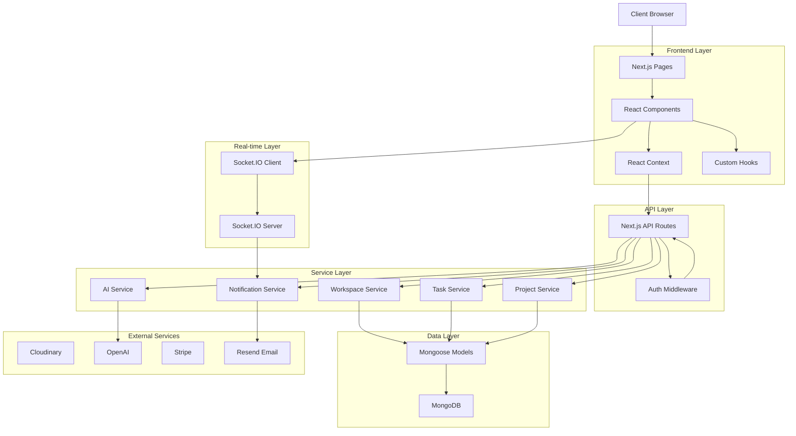
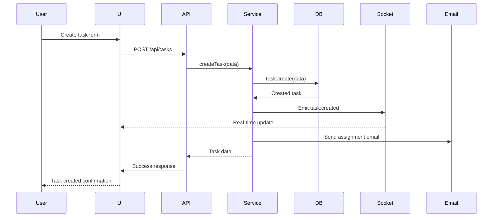
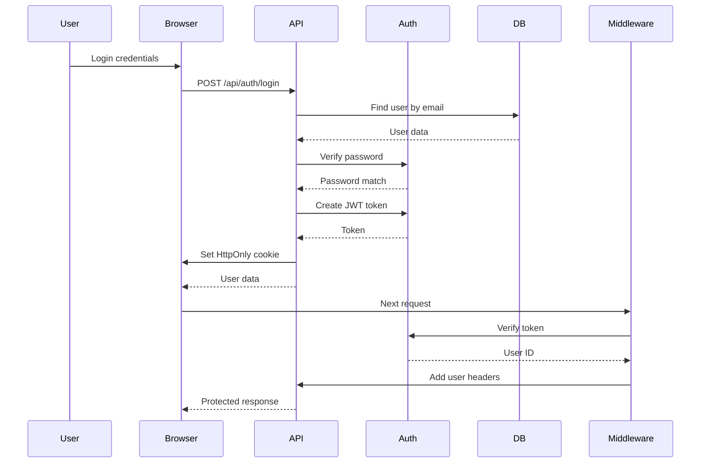
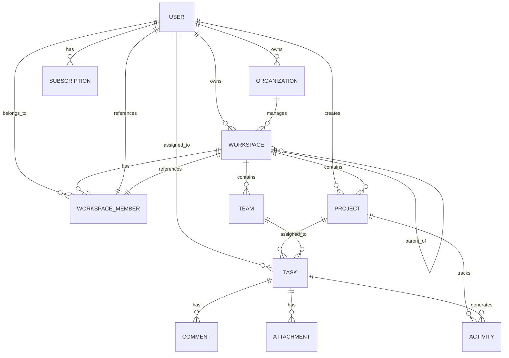
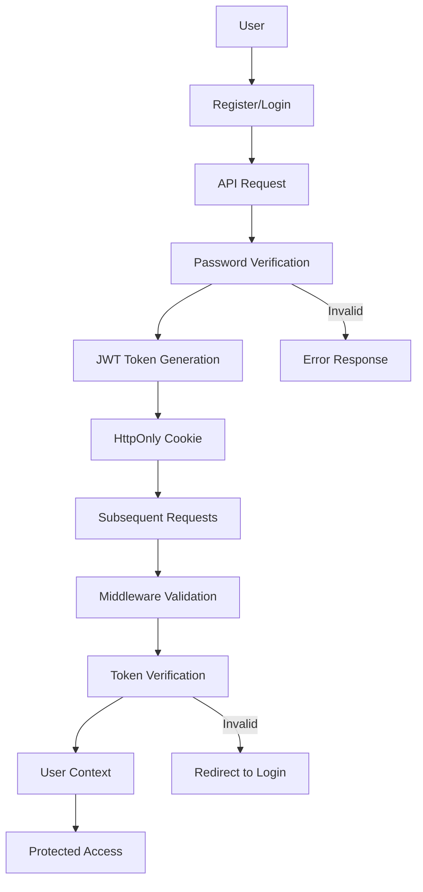

# SprintForge

A modern, full-stack project management platform built with Next.js 16, MongoDB, and real-time collaboration features. SprintForge enables teams to organize work, manage tasks, track progress, and collaborate seamlessly with AI-powered features and enterprise-grade security.

## Table of Contents

- [Overview](#overview)
- [Features](#features)
- [Technology Stack](#technology-stack)
- [Architecture](#architecture)
- [Architecture Diagram](#architecture-diagram)
- [Project Structure](#project-structure)
- [How It Works](#how-it-works)
- [Core Features](#core-features)
- [Request / Data Flow](#request--data-flow)
- [Database](#database)
- [Database Schema](#database-schema)
- [API Documentation](#api-documentation)
- [Authentication & Authorization](#authentication--authorization)
- [Configuration](#configuration)
- [Environment Variables](#environment-variables)
- [Installation](#installation)
- [Development Setup](#development-setup)
- [Running the Project](#running-the-project)
- [Available Commands](#available-commands)
- [Testing](#testing)
- [Build](#build)
- [Deployment](#deployment)
- [Docker](#docker)
- [Security](#security)
- [Error Handling](#error-handling)
- [Troubleshooting](#troubleshooting)
- [Known Limitations](#known-limitations)
- [Performance Considerations](#performance-considerations)
- [Development Guidelines](#development-guidelines)
- [Contributing](#contributing)
- [Future Improvements](#future-improvements)
- [License](#license)

## Overview

SprintForge is a comprehensive project management solution designed for modern software development teams. It combines task management, real-time collaboration, AI-powered features, and enterprise security into a unified platform. The application supports hierarchical workspaces, project organization, agile task management with Kanban boards, team collaboration, and extensive integration capabilities.

## Features

### Core Functionality
- **Workspace Management**: Create and manage multiple workspaces with hierarchical organization
- **Project Organization**: Group tasks into projects with progress tracking
- **Task Management**: Create, assign, and track tasks with priorities, due dates, and status
- **Real-time Collaboration**: Socket.IO-powered real-time updates across the platform
- **Team Management**: Organize team members with role-based access control
- **Kanban Boards**: Visual task management with drag-and-drop interfaces
- **AI Integration**: OpenAI-powered task breakdown and project summaries
- **File Management**: Cloudinary-powered file uploads and management
- **Notifications**: Real-time notification system for task assignments and updates
- **Analytics**: Dashboard with project metrics and activity tracking

### Enterprise Features
- **Multi-tenant Architecture**: Organization-level management with workspace inheritance
- **Compliance & Security**: PII scanning, data retention policies, audit logging
- **Identity Provider Integration**: Support for Okta, Azure AD, Google, and SAML
- **Billing Integration**: Stripe-powered subscription management
- **Webhook System**: Custom webhook endpoints for integrations
- **Role-Based Access Control**: Granular permissions at workspace and organization levels

## Technology Stack

### Frontend
- **Framework**: Next.js 16.2.10 (App Router)
- **Language**: TypeScript 5.x
- **UI Components**: React 19.2.4
- **Styling**: Tailwind CSS 4.3.2
- **Component Library**: Base UI, Shadcn components
- **Icons**: Lucide React, React Icons
- **Forms**: React Hook Form with Zod validation
- **Drag & Drop**: @hello-pangea/dnd
- **Charts**: Recharts
- **Calendar**: React Big Calendar
- **Notifications**: React Hot Toast
- **State Management**: React Context API
- **Real-time**: Socket.IO Client

### Backend
- **Runtime**: Node.js
- **Framework**: Next.js API Routes
- **Database**: MongoDB 7.5.0
- **ORM**: Mongoose 9.7.4
- **Authentication**: JWT (Jose library)
- **Real-time**: Socket.IO 4.8.3
- **File Storage**: Cloudinary 2.10.0
- **AI**: OpenAI 7.0.0
- **Payments**: Stripe 22.3.2
- **Email**: Resend 6.18.0
- **Security**: Helmet, bcryptjs, express-rate-limit
- **Logging**: Pino

### Development Tools
- **Package Manager**: npm
- **Linting**: ESLint 9
- **Formatting**: Prettier 3.9.5
- **Type Checking**: TypeScript

## Architecture

SprintForge follows a modern full-stack architecture with clear separation of concerns:

### Application Layers
1. **Presentation Layer**: Next.js App Router with React components
2. **API Layer**: Next.js API routes handling HTTP requests
3. **Service Layer**: Business logic encapsulated in service modules
4. **Data Access Layer**: Mongoose models for database operations
5. **Database Layer**: MongoDB for persistent storage
6. **Real-time Layer**: Socket.IO for live updates

### Module Boundaries
- **`app/`**: Next.js App Router pages and API routes
- **`components/`**: Reusable React components organized by feature
- **`services/`**: Business logic and data operations
- **`models/`**: Mongoose schema definitions
- **`lib/`**: Utility functions and client configurations
- **`context/`**: React Context providers for global state
- **`hooks/`**: Custom React hooks
- **`types/`**: TypeScript type definitions
- **`utils/`**: Helper functions and constants

### Communication Patterns
- **HTTP/REST**: Standard API communication
- **WebSocket**: Real-time updates via Socket.IO
- **Context API**: Client-side state management
- **Service Pattern**: Business logic isolation

## Architecture Diagram



## Project Structure

```
sprintforge/
├── app/                          # Next.js App Router
│   ├── (auth)/                   # Authentication pages
│   │   ├── login/
│   │   ├── register/
│   │   └── forgot-password/
│   ├── api/                      # API routes
│   │   ├── activities/
│   │   ├── admin/
│   │   ├── ai/
│   │   ├── analytics/
│   │   ├── attachments/
│   │   ├── auth/
│   │   ├── billing/
│   │   ├── comments/
│   │   ├── email/
│   │   ├── files/
│   │   ├── notifications/
│   │   ├── projects/
│   │   ├── search/
│   │   ├── tasks/
│   │   ├── teams/
│   │   ├── time/
│   │   ├── upload/
│   │   ├── users/
│   │   ├── workspace/
│   │   └── workspaces/
│   ├── dashboard/                # Dashboard pages
│   ├── pricing/                  # Pricing pages
│   ├── profile/                  # User profile pages
│   ├── tasks/                    # Task management pages
│   ├── unauthorized/             # Unauthorized access page
│   └── workspace/                # Workspace pages
├── components/                   # React components
│   ├── admin/                    # Admin components
│   ├── ai/                       # AI feature components
│   ├── analytics/                # Analytics components
│   ├── auth/                     # Authentication components
│   ├── billing/                  # Billing components
│   ├── board/                    # Kanban board components
│   ├── calendar/                 # Calendar components
│   ├── dashboard/                # Dashboard components
│   ├── files/                    # File management components
│   ├── filters/                  # Filter components
│   ├── landing/                  # Landing page components
│   ├── layout/                   # Layout components
│   ├── modals/                   # Modal components
│   ├── notifications/            # Notification components
│   ├── profile/                  # Profile components
│   ├── project/                  # Project components
│   ├── realtime/                 # Real-time components
│   ├── search/                   # Search components
│   ├── task/                     # Task components
│   ├── team/                     # Team components
│   ├── templates/               # Template components
│   ├── time/                     # Time tracking components
│   ├── ui/                       # UI components
│   ├── upload/                   # Upload components
│   └── workspace/                # Workspace components
├── context/                      # React Context providers
│   ├── AuthContext.tsx           # Authentication context
│   └── WorkspaceContext.tsx     # Workspace context
├── hooks/                        # Custom React hooks
│   ├── useAuth.ts
│   ├── useBrowserNotification.ts
│   ├── useDebounceSlugValidation.ts
│   ├── useLocalStorageSubscription.ts
│   ├── useNotifications.ts
│   ├── useOptimisticState.ts
│   └── useSocket.ts
├── lib/                          # Utility libraries
│   ├── admin.ts
│   ├── api.ts                    # API request helper
│   ├── auth.ts                   # JWT functions
│   ├── cloudinary.ts             # Cloudinary config
│   ├── db.ts                     # MongoDB connection
│   ├── email.ts
│   ├── logger.ts
│   ├── openai.ts                 # OpenAI config
│   ├── rate-limit.ts
│   ├── security.ts
│   ├── seo.ts
│   ├── socket-client.ts
│   ├── socket.ts
│   ├── stripe.ts                 # Stripe config
│   ├── upload.ts                 # File upload functions
│   └── utils.ts
├── models/                       # Mongoose models
│   ├── Activity.ts
│   ├── Attachment.ts
│   ├── AuditLog.ts
│   ├── Comment.ts
│   ├── File.ts
│   ├── Notification.ts
│   ├── Organization.ts
│   ├── Permission.ts
│   ├── Project.ts
│   ├── Subscription.ts
│   ├── Task.ts
│   ├── Team.ts
│   ├── TimeEntry.ts
│   ├── User.ts
│   ├── Workspace.ts
│   └── WorkspaceMember.ts
├── services/                     # Business logic services
│   ├── activity.service.ts
│   ├── admin.service.ts
│   ├── ai-description.service.ts
│   ├── ai.service.ts
│   ├── analytics.service.ts
│   ├── attachment.service.ts
│   ├── audit.service.ts
│   ├── auth.service.ts
│   ├── billing.service.ts
│   ├── calendar.service.ts
│   ├── comment.service.ts
│   ├── dashboard.service.ts
│   ├── data-retention.service.ts
│   ├── email.service.ts
│   ├── file.service.ts
│   ├── idp-mapping.service.ts
│   ├── notification.service.ts
│   ├── plan.service.ts
│   ├── project.service.ts
│   ├── search.service.ts
│   ├── task.service.ts
│   ├── team.service.ts
│   ├── time.service.ts
│   ├── vcs-provisioning.service.ts
│   ├── webhook.service.ts
│   └── workspace.service.ts
├── types/                        # TypeScript definitions
│   ├── auth.ts
│   ├── database.ts
│   ├── mongoose.d.ts
│   ├── project.ts
│   ├── task.ts
│   └── user.ts
├── utils/                        # Helper utilities
│   ├── constants.ts
│   ├── error-handler.ts
│   ├── response.ts
│   └── validators.ts
├── server/                       # Server configuration
│   └── socket.ts                 # Socket.IO server
├── public/                       # Static assets
├── middleware.ts                 # Next.js middleware
├── next.config.ts                # Next.js configuration
├── tailwind.config.js            # Tailwind CSS configuration
├── tsconfig.json                 # TypeScript configuration
├── package.json                  # Dependencies and scripts
└── .env.local                    # Environment variables (gitignored)
```

## How It Works

### Request Flow
1. **Client Request**: User interacts with React components
2. **API Call**: Components use `apiRequest()` helper to call API routes
3. **Middleware**: Authentication middleware validates JWT tokens
4. **Service Layer**: Business logic is executed in service modules
5. **Database Operations**: Mongoose models interact with MongoDB
6. **Response**: Data flows back through the same layers
7. **Real-time Updates**: Socket.IO broadcasts changes to connected clients

### Authentication Flow
1. **Registration**: User registers via `/api/auth/register`
2. **Password Hashing**: Passwords are hashed using bcryptjs
3. **Token Generation**: JWT tokens are created with 7-day expiration
4. **Token Storage**: HttpOnly cookies store tokens securely
5. **Middleware Validation**: Each protected route validates tokens
6. **User Context**: AuthContext maintains user state globally

### Real-time Collaboration
1. **Socket Connection**: Clients connect via Socket.IO with JWT authentication
2. **Room Management**: Users join rooms for workspaces and projects
3. **Event Broadcasting**: Changes are broadcast to relevant rooms
4. **Optimistic Updates**: UI updates immediately before server confirmation
5. **Event Handlers**: Components listen for specific events

## Core Features

### Workspace Management
- **Hierarchical Structure**: Support for parent-child workspace relationships
- **Organization Integration**: Workspaces can belong to organizations
- **Member Management**: Role-based access control with permissions
- **Settings Customization**: Default task views, priorities, and notifications
- **Compliance Features**: PII scanning, data retention, audit logging
- **Integration Support**: Slack, Teams, GitHub, GitLab, calendar integrations

### Task Management
- **Multiple Views**: List, Kanban board, and calendar views
- **Task Properties**: Title, description, assignee, priority, due date, status
- **Drag & Drop**: Kanban board with drag-and-drop task management
- **Task Filtering**: Filter by status, priority, assignee, and project
- **AI Integration**: AI-powered task breakdown and descriptions
- **Real-time Updates**: Live task updates via Socket.IO

### Project Organization
- **Project Creation**: Create projects within workspaces
- **Progress Tracking**: Automatic progress calculation based on task completion
- **Status Management**: PLANNING, ACTIVE, COMPLETED, ARCHIVED states
- **Task Grouping**: Tasks are organized within projects

### Team Collaboration
- **Team Management**: Create teams within workspaces
- **Member Roles**: Admin, developer, designer, project manager, viewer roles
- **Task Assignment**: Assign tasks to individual team members
- **Activity Tracking**: Activity feed showing team actions
- **Notifications**: Real-time notifications for assignments and updates

### AI Features
- **Task Breakdown**: OpenAI-powered breakdown of complex tasks into subtasks
- **Project Summaries**: AI-generated project summaries
- **Smart Descriptions**: AI-assisted task description generation

## Request / Data Flow

### Task Creation Flow


### Authentication Flow


## Database

### Database Technology
- **Database**: MongoDB 7.5.0
- **ODM**: Mongoose 9.7.4
- **Connection**: Singleton connection pattern for Next.js hot reload
- **Indexing**: Strategic indexes on frequently queried fields

### Connection Management
The application uses a cached MongoDB connection to prevent connection pool exhaustion during Next.js hot reload in development. The connection is established once and reused across API requests.

## Database Schema

### Entity Relationships


### Core Models

#### User
```typescript
{
  name: string
  email: string (unique)
  password: string (hashed)
  avatar?: string
  role: 'USER' | 'ADMIN'
  createdAt: Date
  updatedAt: Date
}
```

#### Workspace
```typescript
{
  name: string
  slug: string (unique)
  description: string
  logo?: string
  owner: ObjectId (ref: User)
  organization?: ObjectId (ref: Organization)
  allowedDomains: string[]
  defaultRole: 'VIEWER' | 'COMMENTER' | 'EDITOR' | 'ADMIN'
  maxMembers: number
  currentMembers: number
  tenantEncryptionKey?: string
  dataRetentionDays: number
  compliancePolicies: {
    piiScanning: boolean
    dataResidency: string
    auditLogging: boolean
  }
  integrations: {
    slack?: { enabled: boolean, channelId?: string }
    teams?: { enabled: boolean, teamId?: string }
    googleCalendar?: { enabled: boolean, calendarId?: string }
    outlookCalendar?: { enabled: boolean, calendarId?: string }
    github?: { enabled: boolean, repositoryUrl?: string }
    gitlab?: { enabled: boolean, repositoryUrl?: string }
  }
  settings: {
    theme?: 'light' | 'dark' | 'system'
    defaultTaskPriority?: 'LOW' | 'MEDIUM' | 'HIGH' | 'URGENT'
    defaultTaskStatus?: 'TODO' | 'IN_PROGRESS' | 'REVIEW' | 'DONE'
    defaultTaskView?: 'LIST' | 'BOARD' | 'CALENDAR'
    weekStartsOn?: 'MONDAY' | 'SUNDAY'
    emailNotifications?: boolean
    taskAssignmentNotifications?: boolean
    dueDateReminders?: boolean
    enableTour?: boolean
    autoCreateRepository?: boolean
    idpGroupMapping?: boolean
  }
  parentWorkspace?: ObjectId (ref: Workspace)
  inheritedPolicies: {
    rbac: boolean
    compliance: boolean
    security: boolean
  }
}
```

#### Project
```typescript
{
  name: string
  description?: string
  workspace: ObjectId (ref: Workspace)
  status: 'PLANNING' | 'ACTIVE' | 'COMPLETED' | 'ARCHIVED'
  progress: number (0-100)
  createdAt: Date
  updatedAt: Date
}
```

#### Task
```typescript
{
  title: string
  description?: string
  project: ObjectId (ref: Project)
  assignee?: ObjectId (ref: User)
  teamId?: ObjectId (ref: Team)
  status: 'TODO' | 'IN_PROGRESS' | 'REVIEW' | 'COMPLETED'
  priority: 'LOW' | 'MEDIUM' | 'HIGH' | 'URGENT'
  dueDate?: Date
  createdAt: Date
  updatedAt: Date
}
```

#### Team
```typescript
{
  name: string
  avatar?: string
  workspace: ObjectId (ref: Workspace)
  description?: string
  members: [{
    _id: ObjectId
    name: string
    email: string
    role: 'admin' | 'developer' | 'designer' | 'project_manager' | 'viewer'
    avatar?: string
  }]
  color?: string
  totalTasksCount?: number
}
```

#### Organization
```typescript
{
  name: string
  slug: string (unique)
  logo?: string
  owner: ObjectId (ref: User)
  allowedDomains: string[]
  defaultWorkspaceSettings: {
    defaultRole: 'VIEWER' | 'COMMENTER' | 'EDITOR' | 'ADMIN'
    maxMembers: number
    dataRetentionDays: number
    piiScanning: boolean
    auditLogging: boolean
  }
  rbacPolicies: {
    roles: Array<{ name: string, permissions: string[] }>
    inheritance: boolean
  }
  securityPolicies: {
    requireMFA: boolean
    sessionTimeout: number
    ipWhitelist: string[]
    encryptionRequired: boolean
  }
  compliancePolicies: {
    dataResidency: string
    gdprCompliant: boolean
    hipaaCompliant: boolean
    soc2Compliant: boolean
  }
  billing: {
    plan: 'FREE' | 'PRO' | 'ENTERPRISE'
    maxWorkspaces: number
    maxMembersPerWorkspace: number
    currentWorkspaces: number
  }
  idpSettings?: {
    provider: 'OKTA' | 'AZURE_AD' | 'GOOGLE' | 'SAML'
    domain: string
    clientId?: string
    groupMappingEnabled: boolean
  }
  webhookEndpoints?: Array<{
    url: string
    events: string[]
    secret: string
    active: boolean
  }>
}
```

## API Documentation

### Authentication Endpoints

#### POST `/api/auth/register`
Register a new user account.

**Request Body:**
```json
{
  "name": "string (min 2 chars)",
  "email": "string (valid email)",
  "password": "string (min 6 chars)"
}
```

**Response:**
```json
{
  "success": true,
  "data": {
    "id": "ObjectId",
    "name": "string",
    "email": "string"
  },
  "message": "Account Created Successfully"
}
```

#### POST `/api/auth/login`
Authenticate user and create session.

**Request Body:**
```json
{
  "email": "string",
  "password": "string"
}
```

**Response:**
```json
{
  "success": true,
  "data": {
    "id": "ObjectId",
    "name": "string",
    "email": "string"
  },
  "message": "Login successful"
}
```

**Cookies:** Sets `token` HttpOnly cookie (7-day expiration)

#### GET `/api/auth/me`
Get current authenticated user.

**Authentication:** Required (JWT token)

**Response:**
```json
{
  "success": true,
  "data": {
    "id": "ObjectId",
    "name": "string",
    "email": "string",
    "role": "USER|ADMIN"
  }
}
```

#### POST `/api/auth/logout`
Logout current user and invalidate session.

**Authentication:** Required

**Response:**
```json
{
  "success": true,
  "message": "Logged out successfully"
}
```

### Workspace Endpoints

#### GET `/api/workspace`
Get all workspaces for current user.

**Authentication:** Required

**Response:**
```json
{
  "success": true,
  "data": [
    {
      "_id": "ObjectId",
      "name": "string",
      "slug": "string",
      "description": "string",
      "owner": { "name": "string", "email": "string" },
      "currentMembers": number,
      "maxMembers": number
    }
  ]
}
```

#### POST `/api/workspace`
Create a new workspace.

**Authentication:** Required

**Request Body:**
```json
{
  "name": "string",
  "slug": "string (optional)",
  "description": "string (optional)",
  "allowedDomains": ["string"],
  "defaultRole": "VIEWER|COMMENTER|EDITOR|ADMIN",
  "maxMembers": number,
  "members": ["string (email)"]
}
```

#### PUT `/api/workspace/[id]`
Update workspace details.

**Authentication:** Required

**Request Body:**
```json
{
  "name": "string",
  "description": "string",
  "settings": {
    "theme": "light|dark|system",
    "defaultTaskPriority": "LOW|MEDIUM|HIGH|URGENT"
  }
}
```

#### DELETE `/api/workspace/[id]`
Delete a workspace and all associated data.

**Authentication:** Required

**Response:**
```json
{
  "success": true,
  "data": { "_id": "ObjectId", "name": "string" }
}
```

### Project Endpoints

#### GET `/api/projects?workspace=workspaceId`
Get all projects for a workspace.

**Authentication:** Required

**Response:**
```json
{
  "success": true,
  "data": [
    {
      "_id": "ObjectId",
      "name": "string",
      "description": "string",
      "workspace": "ObjectId",
      "status": "PLANNING|ACTIVE|COMPLETED|ARCHIVED",
      "progress": number
    }
  ]
}
```

#### POST `/api/projects`
Create a new project.

**Authentication:** Required

**Request Body:**
```json
{
  "name": "string",
  "description": "string (optional)",
  "workspace": "ObjectId"
}
```

### Task Endpoints

#### GET `/api/tasks?project=projectId`
Get all tasks for a project.

**Authentication:** Required

**Response:**
```json
{
  "success": true,
  "data": [
    {
      "_id": "ObjectId",
      "title": "string",
      "description": "string",
      "project": "ObjectId",
      "assignee": { "name": "string", "email": "string" },
      "teamId": { "name": "string" },
      "status": "TODO|IN_PROGRESS|REVIEW|COMPLETED",
      "priority": "LOW|MEDIUM|HIGH|URGENT",
      "dueDate": "ISODate"
    }
  ]
}
```

#### POST `/api/tasks`
Create a new task.

**Authentication:** Required

**Request Body:**
```json
{
  "title": "string",
  "description": "string (optional)",
  "project": "ObjectId",
  "teamId": "ObjectId (optional)",
  "priority": "LOW|MEDIUM|HIGH|URGENT",
  "status": "TODO|IN_PROGRESS|REVIEW|COMPLETED",
  "assignee": "ObjectId (optional)",
  "dueDate": "ISODate (optional)"
}
```

#### PUT `/api/tasks/[id]`
Update a task.

**Authentication:** Required

**Request Body:**
```json
{
  "title": "string",
  "status": "TODO|IN_PROGRESS|REVIEW|COMPLETED",
  "priority": "LOW|MEDIUM|HIGH|URGENT",
  "assignee": "ObjectId"
}
```

**Socket Events:** Emits `task:updated` to project room

#### DELETE `/api/tasks/[id]`
Delete a task.

**Authentication:** Required

**Socket Events:** Emits `task:deleted` to project room

### File Upload Endpoints

#### POST `/api/upload`
Upload a file to Cloudinary.

**Authentication:** Required

**Request:** `multipart/form-data`
- `file`: File object
- `folder`: string (optional, default: "sprintforge")
- `resourceType`: "image|auto|raw|video" (optional, default: "image")

**Response:**
```json
{
  "success": true,
  "data": {
    "url": "string",
    "publicId": "string",
    "width": number,
    "height": number,
    "format": "string"
  },
  "message": "File uploaded successfully"
}
```

**Constraints:**
- Max file size: 5MB
- Allowed formats: jpg, jpeg, png, gif, webp

### AI Endpoints

#### POST `/api/ai/task-breakdown`
Generate AI-powered task breakdown.

**Authentication:** Required

**Request Body:**
```json
{
  "task": "string"
}
```

**Response:**
```json
{
  "success": true,
  "data": {
    "subtasks": [
      {
        "title": "string",
        "description": "string",
        "priority": "HIGH|MEDIUM|LOW",
        "estimatedDays": number
      }
    ]
  }
}
```

#### POST `/api/ai/summary`
Generate AI-powered project summary.

**Authentication:** Required

**Request Body:**
```json
{
  "project": "string"
}
```

**Response:**
```json
{
  "success": true,
  "data": {
    "summary": "string"
  }
}
```

### Notification Endpoints

#### GET `/api/notifications`
Get user notifications.

**Authentication:** Required

**Response:**
```json
{
  "success": true,
  "data": [
    {
      "_id": "ObjectId",
      "user": "ObjectId",
      "type": "TASK_ASSIGNED|TASK_UPDATED|PROJECT_CREATED",
      "title": "string",
      "message": "string",
      "link": "string",
      "read": boolean,
      "createdAt": "ISODate"
    }
  ]
}
```

#### PUT `/api/notifications/[id]/read`
Mark notification as read.

**Authentication:** Required

#### POST `/api/notifications/read-all`
Mark all notifications as read.

**Authentication:** Required

## Authentication & Authorization

### Authentication Flow


### Authorization Levels
- **USER**: Standard user access
- **ADMIN**: Administrative access to admin routes
- **Workspace Roles**: VIEWER, COMMENTER, EDITOR, ADMIN, OWNER
- **Team Roles**: admin, developer, designer, project_manager, viewer

### Protected Routes
- `/dashboard/*` - Requires authentication
- `/workspace/*` - Requires authentication
- `/tasks/*` - Requires authentication
- `/profile/*` - Requires authentication
- `/analytics/*` - Requires authentication
- `/settings/*` - Requires authentication
- `/dashboard/admin/*` - Requires ADMIN role

### Middleware Configuration
The middleware.ts file handles:
- JWT token verification
- Role-based access control
- User context injection
- Secure redirects
- SEO headers for protected routes

## Configuration

### Application Configuration
- **Next.js Config**: Custom security headers in next.config.ts
- **TypeScript Config**: Strict mode with path aliases
- **Tailwind Config**: Custom design system configuration
- **ESLint Config**: Next.js recommended rules with Prettier

### Security Headers
```typescript
X-Frame-Options: DENY
X-Content-Type-Options: nosniff
Referrer-Policy: strict-origin-when-cross-origin
Permissions-Policy: camera=(), microphone=()
```

## Environment Variables

### Required Variables
```env
MONGODB_URI=mongodb://localhost:27017/sprintforge
JWT_SECRET=your_jwt_secret_key
NEXT_PUBLIC_APP_URL=http://localhost:3000
```

### Optional Variables
```env
# Cloudinary (for file uploads)
CLOUDINARY_CLOUD_NAME=your_cloudinary_cloud_name
CLOUDINARY_API_KEY=your_cloudinary_api_key
CLOUDINARY_API_SECRET=your_cloudinary_api_secret

# OpenAI (for AI features)
OPENAI_API_KEY=your_openai_api_key

# Stripe (for payments)
STRIPE_SECRET_KEY=your_stripe_secret_key
NEXT_PUBLIC_STRIPE_PUBLISHABLE_KEY=your_stripe_publishable_key

# Resend (for emails)
RESEND_API_KEY=your_resend_api_key

# Environment
NODE_ENV=development
```

### Environment Setup
1. Copy `.env.example` to `.env.local` (if available)
2. Add required environment variables
3. Never commit `.env.local` to version control
4. Use different values for development and production

## Installation

### Prerequisites
- **Node.js**: 20.x or higher
- **MongoDB**: 7.5.0 or higher (local instance or MongoDB Atlas)
- **npm**: Latest version
- **Git**: For version control

### Installation Steps

1. **Clone the repository**
```bash
git clone <repository-url>
cd sprintforge
```

2. **Install dependencies**
```bash
npm install
```

3. **Set up environment variables**
```bash
# Create .env.local file
# Add required environment variables
# See Environment Variables section for details
```

4. **Set up MongoDB**
```bash
# For local MongoDB:
# Ensure MongoDB is running on default port 27017
# Or update MONGODB_URI in .env.local

# For MongoDB Atlas:
# Get connection string from Atlas dashboard
# Update MONGODB_URI in .env.local
```

5. **Configure external services (optional)**
```bash
# Cloudinary for file uploads
# OpenAI for AI features
# Stripe for payments
# Resend for emails
```

## Development Setup

### Running Development Server
```bash
npm run dev
```
The application will be available at `http://localhost:3000`

### Database Connection
The application automatically connects to MongoDB using the `MONGODB_URI` from environment variables. The connection is cached to prevent connection pool exhaustion during hot reload.

### Socket.IO Server
The Socket.IO server is initialized when the Next.js server starts. It runs on the same server instance and handles real-time communication.

## Running the Project

### Development Mode
```bash
npm run dev
```
- Hot reload enabled
- Detailed error messages
- Debug logging enabled

### Production Mode
```bash
npm run build
npm start
```
- Optimized production build
- Minified code
- Performance optimizations

### Accessing the Application
1. Open browser to `http://localhost:3000`
2. Register a new account or login
3. Create a workspace
4. Create projects within the workspace
5. Add tasks to projects
6. Invite team members

## Available Commands

### Development
```bash
npm run dev          # Start development server
npm run build        # Build for production
npm start            # Start production server
npm run lint         # Run ESLint
```

### Script Details
- **dev**: Starts Next.js development server with hot reload
- **build**: Creates optimized production build
- **start**: Starts production server (requires build first)
- **lint**: Runs ESLint to check code quality

## Testing

### Current Testing Status
**No test suite is currently implemented in the project.**

### Recommended Testing Framework
For future implementation, consider:
- **Unit Tests**: Jest with React Testing Library
- **Integration Tests**: Next.js API route testing
- **E2E Tests**: Playwright or Cypress
- **Type Tests**: TypeScript compiler checks

### Testing Goals
When implementing tests, focus on:
- Service layer business logic
- API route endpoints
- Authentication flows
- Database operations
- Component interactions

## Build

### Production Build
```bash
npm run build
```

### Build Output
Build artifacts are placed in `.next/` directory (gitignored). The build process:
- Compiles TypeScript to JavaScript
- Optimizes React components
- Minifies code
- Generates static assets
- Creates serverless function bundles

### Build Optimization
- Automatic code splitting
- Tree shaking
- Asset optimization
- Font optimization
- Image optimization

## Deployment

### Deployment Platforms
SprintForge can be deployed to:
- **Vercel**: Recommended for Next.js applications
- **Netlify**: Alternative platform with Next.js support
- **Docker**: Containerized deployment
- **Self-hosted**: VPS or cloud infrastructure

### Vercel Deployment
1. Connect repository to Vercel
2. Add environment variables in Vercel dashboard
3. Deploy automatically on push to main branch
4. Configure custom domain if needed

### Environment Variables for Production
Ensure all required environment variables are set in the deployment platform:
- `MONGODB_URI`: Production MongoDB connection string
- `JWT_SECRET`: Strong, random secret key
- `NEXT_PUBLIC_APP_URL`: Production domain URL
- External service API keys (Cloudinary, OpenAI, Stripe, etc.)

### Database Deployment
- Use MongoDB Atlas for production
- Configure IP whitelist
- Enable authentication
- Set up automated backups
- Monitor connection limits

## Docker

### Dockerfile
**No Dockerfile is currently present in the project.**

### Recommended Docker Setup
For containerized deployment, create a `Dockerfile` with:
- Node.js base image
- Dependency installation
- Build process
- Production server startup
- Environment variable configuration

### Docker Compose
For local development with Docker Compose, include:
- Application container
- MongoDB container
- Environment configuration
- Volume mounts for development

## Security

### Security Implementation

#### Authentication
- **JWT Tokens**: 7-day expiration with HttpOnly cookies
- **Password Hashing**: bcryptjs with salt factor of 12
- **Token Verification**: Middleware validates on protected routes
- **Secure Headers**: Custom security headers in Next.js config

#### Authorization
- **Role-Based Access**: USER and ADMIN roles
- **Workspace Permissions**: VIEWER, COMMENTER, EDITOR, ADMIN, OWNER
- **Route Protection**: Middleware enforces authentication requirements
- **Admin Routes**: Additional ADMIN role verification

#### Data Protection
- **PII Scanning**: Automatic detection and redaction of sensitive data
- **Input Validation**: Zod schemas for API input validation
- **SQL Injection Prevention**: Mongoose parameterized queries
- **XSS Protection**: React's built-in XSS protection
- **CSRF Protection**: SameSite cookie attributes

#### File Upload Security
- **File Size Limits**: 5MB maximum file size
- **MIME Type Validation**: Allowed image formats only
- **Cloudinary Security**: Signed uploads with access controls
- **File Scanning**: Basic validation before upload

#### API Security
- **Rate Limiting**: express-rate-limit for API protection
- **CORS Configuration**: Configured for specific origins
- **Helmet**: Security headers for Express/Next.js
- **Environment Variables**: Sensitive data in environment files

### Security Best Practices
- Never commit `.env.local` to version control
- Use strong, random JWT secrets
- Enable MongoDB authentication
- Use HTTPS in production
- Regular dependency updates
- Monitor security advisories
- Implement backup strategies

## Error Handling

### Error Handling Strategy

#### API Errors
- **Validation Errors**: 400 status with field-specific messages
- **Authentication Errors**: 401 status with redirect to login
- **Authorization Errors**: 403 status with permission message
- **Not Found Errors**: 404 status with resource message
- **Server Errors**: 500 status with generic error message

#### Client Errors
- **Network Errors**: User-friendly error messages
- **Form Validation**: Real-time validation feedback
- **Loading States**: Loading indicators during async operations
- **Error Boundaries**: React error boundaries for component errors

#### Database Errors
- **Connection Errors**: Retry logic with exponential backoff
- **Validation Errors**: Schema validation with detailed messages
- **Duplicate Key Errors**: Unique constraint violation messages
- **Transaction Errors**: Rollback with error logging

### Error Response Format
```json
{
  "success": false,
  "message": "Error description",
  "error": "Detailed error information"
}
```

### Logging
- **Development**: Detailed console logging
- **Production**: Structured logging with Pino
- **Error Tracking**: Centralized error handling
- **Audit Logging**: Workspace action tracking

## Troubleshooting

### Common Issues

#### MongoDB Connection Issues
**Problem**: Cannot connect to MongoDB
**Solution**:
- Verify MongoDB is running
- Check `MONGODB_URI` in `.env.local`
- Ensure network connectivity
- Check MongoDB authentication credentials

#### Authentication Issues
**Problem**: Users cannot login
**Solution**:
- Verify JWT_SECRET is set
- Check cookie settings in browser
- Verify token expiration (7 days)
- Check middleware configuration

#### File Upload Issues
**Problem**: File uploads fail
**Solution**:
- Verify Cloudinary credentials
- Check file size limits (5MB)
- Ensure allowed file formats
- Check network connectivity

#### Socket.IO Connection Issues
**Problem**: Real-time updates not working
**Solution**:
- Verify Socket.IO server is running
- Check JWT token for socket authentication
- Ensure CORS configuration is correct
- Check room membership

#### Build Issues
**Problem**: Build fails
**Solution**:
- Clear `.next` directory
- Delete `node_modules` and reinstall
- Check TypeScript errors
- Verify environment variables

## Known Limitations

### Current Limitations
1. **No Test Suite**: No automated tests are implemented
2. **No Docker Configuration**: Containerization setup not provided
3. **No CI/CD Pipeline**: Automated deployment not configured
4. **Limited Error Recovery**: Some error scenarios lack handling
5. **No Rate Limiting**: API rate limiting is not fully implemented
6. **No Caching Layer**: No Redis or caching mechanism
7. **Limited Monitoring**: No application performance monitoring
8. **No Backup Strategy**: No automated backup system

### Technical Debt
1. **Console Logging**: Extensive console.log statements should be replaced with proper logging
2. **Type Safety**: Some areas use `any` type instead of proper typing
3. **Error Handling**: Inconsistent error handling across services
4. **Code Duplication**: Some repeated patterns could be abstracted
5. **Performance**: Some database queries could be optimized with indexes

### Missing Features
1. **Mobile App**: No native mobile application
2. **Offline Support**: No offline mode or service workers
3. **Advanced Search**: Limited search capabilities
4. **Advanced Analytics**: Basic analytics only
5. **Custom Fields**: No custom task/project fields
6. **Advanced Permissions**: Granular permissions could be improved

## Performance Considerations

### Database Performance
- **Connection Pooling**: Cached MongoDB connection (max 10 connections)
- **Indexing**: Strategic indexes on frequently queried fields
- **Query Optimization**: Use `.lean()` for read operations
- **Population**: Selective population of related documents

### Frontend Performance
- **Code Splitting**: Automatic code splitting by Next.js
- **Image Optimization**: Next.js Image component usage
- **Lazy Loading**: Component lazy loading where appropriate
- **Optimistic Updates**: UI updates before server confirmation
- **Debouncing**: Input debouncing for search and validation

### API Performance
- **Service Layer**: Business logic separation for reusability
- **Caching Strategy**: Consider implementing Redis for frequently accessed data
- **Pagination**: Implement pagination for large datasets
- **Compression**: Enable response compression

### Recommendations
1. Add Redis for session and data caching
2. Implement database query monitoring
3. Add CDN for static assets
4. Consider server-side rendering for SEO-critical pages
5. Implement request queuing for heavy operations

## Development Guidelines

### Code Style
- **TypeScript**: Strict mode enabled
- **ESLint**: Follow Next.js recommended rules
- **Prettier**: Consistent code formatting
- **File Naming**: kebab-case for files, PascalCase for components

### Component Guidelines
- **Functional Components**: Use functional components with hooks
- **Type Safety**: Proper TypeScript typing for props and state
- **Separation of Concerns**: Keep UI separate from business logic
- **Reusable Components**: Create reusable UI components
- **Error Boundaries**: Implement error boundaries for error handling

### API Guidelines
- **Service Layer**: Use service layer for business logic
- **Validation**: Validate inputs with Zod schemas
- **Error Handling**: Consistent error responses
- **Authentication**: Protect routes with middleware
- **Documentation**: Document API endpoints

### Database Guidelines
- **Models**: Use Mongoose models for schema definition
- **Validation**: Schema-level validation where appropriate
- **Indexes**: Add indexes for frequently queried fields
- **Transactions**: Use transactions for multi-document operations
- **Relationships**: Use proper references and population

### Git Workflow
- **Branching**: Feature branches for new features
- **Commits**: Descriptive commit messages
- **Pull Requests**: Code review before merging
- **Semantic Versioning**: Follow semantic versioning for releases

## Contributing

### Contribution Guidelines
1. Fork the repository
2. Create a feature branch
3. Make your changes
4. Follow code style guidelines
5. Test your changes thoroughly
6. Submit a pull request
7. Address review feedback

### Code Review Process
- Ensure code follows project conventions
- Verify TypeScript types are correct
- Check for security vulnerabilities
- Test functionality manually
- Update documentation if needed

### Issue Reporting
- Use GitHub issues for bug reports
- Provide detailed reproduction steps
- Include environment information
- Add relevant error logs
- Suggest potential solutions

## Future Improvements

### Planned Features
1. **Test Suite**: Implement comprehensive testing
2. **CI/CD Pipeline**: Automated testing and deployment
3. **Mobile Application**: React Native mobile app
4. **Advanced Analytics**: Enhanced analytics and reporting
5. **Custom Fields**: User-defined custom fields
6. **Offline Support**: PWA with offline capabilities
7. **Advanced Search**: Full-text search with filters
8. **Performance Monitoring**: APM integration
9. **Backup System**: Automated backup and recovery
10. **API Documentation**: OpenAPI/Swagger documentation

### Technical Improvements
1. **Redis Integration**: Caching layer for performance
2. **Queue System**: Background job processing
3. **Microservices**: Potential microservice architecture
4. **GraphQL**: Consider GraphQL for API
5. **WebAssembly**: Performance-critical operations
6. **Edge Functions**: Edge computing for global performance

### Security Enhancements
1. **MFA Support**: Multi-factor authentication
2. **Audit Logs**: Enhanced audit logging
3. **Data Encryption**: Enhanced encryption capabilities
4. **Rate Limiting**: Advanced rate limiting
5. **Security Headers**: Enhanced security headers

## License

This project is proprietary software. All rights reserved.

---

**Note**: This README is based on the actual implementation found in the codebase. For the most accurate and up-to-date information, always refer to the source code and inline documentation.